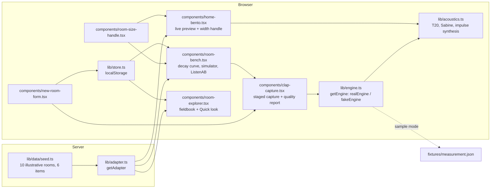

# Decaya

Clap once in your room. Decaya measures the echo, works out which rug or curtain will fix it, and lets you hear the result before you buy.

Students who record podcasts, covers and class presentations in a dorm usually blame the microphone, when the room is what rings; Decaya shows the decay per octave band and plays the same sentence through the room as it is and as it would be.

**Live:** https://decaya.vercel.app. Start with step 1 of `DEMO.md`: on the home page, press "Thick curtain" and "Duvet on the wall" in the largest card and watch the predicted bars drop toward the green speech strip.

**Source:** https://github.com/mericcintosun/decaya

## Try it in 60 seconds

1. Open https://decaya.vercel.app. In the largest card, press "Thick curtain" and "Duvet on the wall". The predicted bars drop into the green strip.
2. Drag the handle under the bars (or use the arrow keys, or type a width). A wider room makes the same items do less, and the predicted decay rises.
3. Press "Listen to the difference". On the room page, press "Your room now", then the "With Thick curtain and Duvet on the wall" button. Same phrase, same loudness, only the decay changes.
4. Press "Measure a room" in the header, clap three times (or load the sample measurement), and save. The room is now first in the fieldbook on the home page.

## How it fits together



All measurement and audio work runs in the visitor's browser. The server only serves the seeded fieldbook; no account, no upload, no API key.

## Quickstart

```bash
npm install
npm run dev        # http://localhost:3000
npm test           # unit tests: acoustics, schemas, room store
npm run proof      # reruns the checks below and rewrites their blocks
```

`ADAPTER_MODE` is the only setting (see `.env.example`): unset or `real` uses the microphone, `ADAPTER_MODE=fake` loads the stored example measurement instead. The microphone needs a secure context (`localhost` or HTTPS).

## Addresses

| What | Where |
| --- | --- |
| Live web app | https://decaya.vercel.app |

## Live measurement or sample data

The page tells you which one ran. "Live measurement" means the deploy uses your microphone (the default); "Sample data" means it loaded the stored example in `fixtures/measurement.json`. The ten fieldbook rooms are illustrative examples, not measurements we took, and every number shown after an item is added is a prediction.

## What is real and what is a fixture

Real, in the browser: microphone capture (raw PCM through an AudioWorklet, `public/worklets/pcm-capture.js`, with a MediaRecorder fallback that the quality report flags), onset detection, the octave filter bank in an `OfflineAudioContext`, Schroeder integration, the T20 fit, clap grading, the Sabine prediction, the synthesized impulse responses and `ConvolverNode` playback.

Fixtures and stand-ins:

- The fieldbook rooms in `lib/data/seed.ts` are illustrative.
- In sample mode the clap button loads `fixtures/measurement.json`. The switch is `getEngine(mode)` in `lib/engine.ts`.
- The dry voice in the A/B player is a formant synth written for this project. The player names the source it used.
- Rooms you measure stay in your browser's localStorage (`lib/store.ts`). There is no server room store.

## How it was tested

We fit T20 (-5 to -25 dB) instead of T30, because phone microphones rarely give 35 clean decibels above the noise floor. The blocks below are written by `npm run proof`. They are synthetic-signal checks, a model prediction, a storage check and a unit test result, not room measurements.

Unit tests (`tests/core.test.ts`, `tests/store.test.ts`):

<!-- PROOF:BEGIN tests -->
Run 2026-11-24: npm test passed 11 of 11 tests in tests/core.test.ts and tests/store.test.ts (node:test through tsx).
<!-- PROOF:END tests -->

T20 on a synthetic decay:

<!-- PROOF:BEGIN synthetic-decay -->
Run 2026-11-24: an ideal exponential decay with RT60 0.9 s (8000 Hz, no noise) went through schroederDb and t20 and read 0.900 s, an error of 0.00 percent.
<!-- PROOF:END synthetic-decay -->

Demo room prediction (3 x 4 x 2.6 m, thick curtain plus duvet on the wall):

<!-- PROOF:BEGIN demo-prediction -->
Run 2026-11-24: demo room 3 x 4 x 2.6 m with the fixture measurement (mid band 0.91 s). Predicted mid band with thick curtain + duvet on the wall: 0.47 s. This is a Sabine prediction, not a measurement.
<!-- PROOF:END demo-prediction -->

Dry voice source:

<!-- PROOF:BEGIN dry-voice -->
Run 2026-11-24: public/audio/dry-speech.wav is not present, so the A/B uses the formant synth voice.
<!-- PROOF:END dry-voice -->

Saved rooms (`lib/store.ts`, in-memory localStorage stand-in):

<!-- PROOF:BEGIN store -->
Run 2026-11-24: lib/store.ts with an in-memory localStorage. Saving the same slug twice left 1 room. A corrupt stored string did not throw and reported parse_failure. Of two stored entries, the one missing its band values was skipped (kept 1, skipped 1).
<!-- PROOF:END store -->

Room tests on real devices: the cross-check against an iOS clap app has not been done yet, so this table has no numbers. A row gets a number only after it has been measured.

| What | How | Result |
| --- | --- | --- |
| Measurement sanity | Same phone, dorm room vs. tiled bathroom | Not measured yet |
| Clap grading | Clap right next to the phone on purpose | Not measured yet |
| Cross-check | Same 3 rooms measured with an iOS clap app | Not measured yet |
| Browsers | Chrome desktop, Safari iOS, Chrome Android | Not measured yet |

## Tech stack

- Next.js 15 (App Router), React 19, TypeScript 5 (strict), Tailwind CSS 4, shadcn-style primitives in `components/ui/`
- Motion 14 (`motion/react`): the shared-layout Quick look, the draggable room width, the staged clap capture
- Zod 3 for route input, fixture and stored-room validation (`lib/schemas.ts`)
- tsx 4 with Node's built-in test runner
- Web Audio API (`getUserMedia`, `AudioWorklet`, `AnalyserNode`, `OfflineAudioContext`, `BiquadFilterNode`, `ConvolverNode`) and Canvas 2D, no audio libraries
- lucide-react icons, Vercel hosting

Bounties: no sponsor bounties; main placement only (see `DELIVERY.md`).

### Reset the demo

1. `npm run demo:reset` rebuilds `fixtures/seed.json` twice in memory, stops if the two builds differ, writes it, and checks the fieldbook still has 10 rooms and 6 furnishings.
2. In the browser, open `/` and press "Clear rooms measured here" (or open a private window).
3. Walk `DEMO.md` from step 1.

Rooms are saved under the localStorage key `decaya.rooms.v1`; entries that fail the stored room schema are skipped when read, and saving the same room twice replaces it.

## What we would build next

- Measure from four spots in the room and average, the way acousticians do
- Early reflections in the synthetic impulse so the preview sounds more like the real room
- A shopping list view: the cheapest plan per room, with where to hang each item

## Credits: reused code, assets and datasets

- Absorption coefficients adapted from Beranek and from Everest's *Master Handbook of Acoustics*. Duvet, bookshelf and bean bag values are our estimates and are labelled that way in the app.
- Scene illustrations (`public/illustrations/`) and the logo are original SVGs drawn for this project.
- Dry voice: no recorded speech clip is included. The A/B player uses a formant synth written for this project (`lib/acoustics.ts`).
- Fonts: Fraunces and Source Sans 3 from Google Fonts (SIL Open Font License), loaded through `next/font`.
- npm packages listed in `package.json`, used under their own licenses.

## AI use

The hackathon rule says AI tools used must be disclosed. We used Claude Code (Anthropic) as the coding assistant for scaffolding, implementation and documentation drafts; product decisions and review are ours. No AI model runs in the product: every number comes from the Web Audio pipeline and Sabine's equation in your browser.

## License

MIT, see `LICENSE`.
